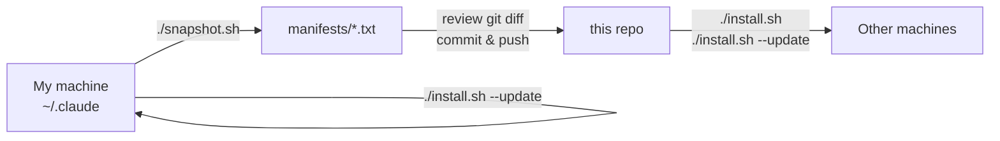

# ai-setup

My personal AI coding setup for [Claude Code](https://claude.com/claude-code): global instructions, settings, my own skills, and the list of third-party plugins and skills I actually use.

It works two ways:

- **Dotfiles**: the source of truth for my machines. `install.sh` symlinks everything into `~/.claude/`.
- **Plugin marketplace**: if you only want my skills, add the marketplace and install a plugin.

## Use it

### Pick some skills (plugin marketplace)

```
/plugin marketplace add florianPalabost/ai-setup
/plugin install laravel@ai-setup
```

| Plugin | Contents |
| --- | --- |
| [`laravel`](plugins/laravel) | `debug-laravel`: root-cause-first debugging workflow built on the [Laravel Boost](https://github.com/laravel/boost) MCP tools |

### Full setup (dotfiles)

```bash
git clone https://github.com/florianPalabost/ai-setup.git ~/dev/ai-setup
cd ~/dev/ai-setup
./install.sh --dry-run   # see what would change
./install.sh
```

`install.sh` is idempotent and **never deletes anything**: whatever it would replace is moved to `~/.claude/backups/ai-setup-<timestamp>/`. The only exception is the [skill mirrors](GLOSSARY.md) it generates itself, kept in sync in place. It:

1. Symlinks `global/AGENTS.md` and `global/CLAUDE.md` into `~/.claude/`
2. Merges `global/settings.json` into `~/.claude/settings.json` (merged, not symlinked, so machine-specific hooks never end up in the repo)
3. Symlinks the skills/commands/agents from `plugins/*/` into `~/.claude/`
4. Adds the marketplaces and installs the plugins listed in [`manifests/plugins.txt`](manifests/plugins.txt)
5. Installs the third-party skills listed in [`manifests/skills.txt`](manifests/skills.txt)

A plain install only adds what's missing; versions already installed are left alone (that's `--update`'s job).

Requirements: `bash`, `git`, `python3`, `claude`, `npx`.

### Update

```bash
./install.sh --update --dry-run   # see what would change
./install.sh --update
```

`--update` does a full install, plus:

1. Pulls this repo (fast-forward only; skipped with a warning if the tree has local changes or has diverged), then re-runs the freshly pulled `install.sh`
2. Updates all marketplaces and every **user-scope** plugin, disabled ones included (they stay disabled)
3. Updates every global `npx skills` skill and pulls every vendored git skill

It updates everything installed, not only what the manifests list. Restart Claude Code afterwards if plugins changed; the script tells you.

## How the setup flows

The reference is what's **installed on my machine**, not the manifests: I try and drop plugins and skills with `claude plugin install` / `npx skills add`, then a snapshot records the result. See [ADR 0001](docs/adr/0001-reference-machine-is-source-of-truth.md) and the [glossary](GLOSSARY.md).



### Snapshot

```bash
./install.sh --update   # bring my machine up to date first
./snapshot.sh           # rewrite manifests/ from what is installed
git diff manifests/     # review, update the "What I use" tables below, commit
```

`snapshot.sh` only writes `manifests/plugins.txt` and `manifests/skills.txt`; it never commits, and it never touches `global/settings.json` (hand-curated, because the live `settings.json` holds machine-specific hooks). It prints what was added or removed. Where each entry comes from:

| Installed on the machine | Read from | Written to |
| --- | --- | --- |
| User-scope plugins and their enabled/disabled state | `claude plugin list --json` + `~/.claude/plugins/known_marketplaces.json` | `plugins.txt` |
| `npx skills` skills | `~/.agents/.skill-lock.json` | `skills.txt` (`skills` lines) |
| Vendored git skills | symlinks in `~/.claude/skills` into the vendor dir (for a skill mirror, the checkout its `.source` names), then `git remote` + path | `skills.txt` (`git` lines) |
| Own skills | symlinks in `~/.claude/skills` into this repo | skipped, already in the repo |
| Anything else in `~/.claude/skills` | | not written; warned as "unknown source" |

Project- and local-scope plugins are never recorded: they belong to their projects. Anything personal goes in [`manifests/ignore.txt`](manifests/ignore.txt) and is left out.

## Layout

```
.claude-plugin/marketplace.json   marketplace listing the plugins below
plugins/<domain>/                 my own skills, grouped by domain
global/AGENTS.md                  global instructions (cross-tool standard)
global/CLAUDE.md                  imports AGENTS.md
global/settings.json              shared Claude Code settings
manifests/plugins.txt             third-party plugins I use (written by snapshot.sh)
manifests/skills.txt              third-party skills I use (written by snapshot.sh)
manifests/ignore.txt              installed, but kept out of the snapshot
templates/                        project .mcp.json example
install.sh                        install / update script
snapshot.sh                       records installed tooling into manifests/
lib.sh                            helpers shared by both scripts
GLOSSARY.md, docs/adr/            vocabulary and design decisions
```

`AGENTS.md` is the single source of instructions; `CLAUDE.md` only contains `@AGENTS.md`, so any tool that reads `AGENTS.md` gets the same rules.

## What I use

### Plugins

| Plugin | Why |
| --- | --- |
| [mattpocock-skills](https://github.com/mattpocock/skills) | My main workflow: `/grill-me`, `/grill-with-docs`, `/to-spec`, `/to-tickets`, `/implement`, `/tdd`, `/code-review`, `/retro`. Run `/ask-matt` to pick the right one. |
| [frontend-design](https://github.com/anthropics/claude-code/tree/main/plugins/frontend-design) | UI design guidance |
| [commit-commands](https://github.com/anthropics/claude-code/tree/main/plugins/commit-commands) | `/commit`, `/commit-push-pr` |
| [php-lsp](https://github.com/anthropics/claude-plugins-official), [typescript-lsp](https://github.com/anthropics/claude-plugins-official), [rust-analyzer-lsp](https://github.com/anthropics/claude-plugins-official) | Code intelligence for my stack (Laravel + React, plus Rust) |
| [impeccable](https://github.com/pbakaus/impeccable) | Installed but **disabled**; enabled per project when needed |

### Skills

| Skill | Source |
| --- | --- |
| `orca-cli`, `orchestration`, `computer-use` | [stablyai/orca](https://github.com/stablyai/orca) |
| `find-skills` | [vercel-labs/skills](https://github.com/vercel-labs/skills) |
| `show-me` | [humanlayer/skills](https://github.com/humanlayer/skills) |
| `unslop` | [cursor/plugins](https://github.com/cursor/plugins) |
| `vercel-react-best-practices`, `web-design-guidelines` | [vercel-labs/agent-skills](https://github.com/vercel-labs/agent-skills) |
| `visual-explainer` (+ `/diff-review`, `/plan-review`, `/project-recap`…) | [nicobailon/visual-explainer](https://github.com/nicobailon/visual-explainer) |

### Per-project tooling (not installed globally)

- [Laravel Boost](https://github.com/laravel/boost): MCP server + skills (Pest, Spatie conventions…) installed per Laravel project with `php artisan boost:install`
- [Spec Kit](https://github.com/github/spec-kit): spec-driven development (`/speckit.*`), initialised per project

[`templates/mcp.json.example`](templates/mcp.json.example) is a starting point for a project `.mcp.json`.

## Security

- Nothing outside the files in this repo is published: no credentials, history, sessions, or memory.
- [gitleaks](https://github.com/gitleaks/gitleaks) runs as a pre-commit hook (`pre-commit install`) and in CI.

## License

[MIT](LICENSE)
