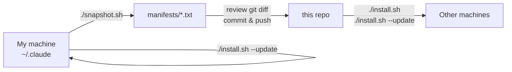

# ai-setup

My personal AI coding setup for [Claude Code](https://claude.com/claude-code): global instructions, settings, my own skills, and the list of third-party plugins and skills I actually use.

It works two ways:

- **Dotfiles**: the source of truth for my machines. `install.sh` symlinks everything into `~/.claude/`.
- **Plugin marketplace**: if you only want my skills, add the marketplace and install a plugin.

## Use it

### Pick some skills (plugin marketplace)

```
/plugin marketplace add florianPalabost/ai-setup
/plugin install laravel@ai-setup
```

| Plugin | Contents |
| --- | --- |
| [`laravel`](plugins/laravel) | `debug-laravel`: root-cause-first debugging workflow built on the [Laravel Boost](https://github.com/laravel/boost) MCP tools |
| [`review`](plugins/review) | `no-comments` + `comment-sicko` agent: deletes narration comments and flags the code they excuse, adapted from [pstack](https://github.com/cursor/plugins/tree/main/pstack) |
| [`writing`](plugins/writing) | `unslop`: removes AI tells from prose, callable from `/pr` and other workflows, adapted from [pstack](https://github.com/cursor/plugins/tree/main/pstack) |

### Full setup (dotfiles)

```bash
git clone https://github.com/florianPalabost/ai-setup.git ~/dev/ai-setup
cd ~/dev/ai-setup
./install.sh --dry-run   # see what would change
./install.sh
```

`install.sh` is idempotent and **never deletes anything**: whatever it would replace is moved to `~/.claude/backups/ai-setup-<timestamp>/`. The only exception is the [skill mirrors](GLOSSARY.md) it generates itself, kept in sync in place. It:

1. Symlinks `global/AGENTS.md`, `global/CLAUDE.md` and `global/RTK.md` into `~/.claude/`
2. Links the [`factory`](factory) CLI into `~/.local/bin` (not on native Windows) and installs what its srt sandbox runs on: `srt` with `npm install -g @anthropic-ai/sandbox-runtime`, then bubblewrap, socat and ripgrep (only ripgrep on macOS) with `brew` or passwordless `apt`. Where `apt` needs a password, the run ends by printing the `sudo apt install …` command to run yourself.
3. Installs [rtk](https://github.com/rtk-ai/rtk) if it's missing (`brew`, `winget` on Windows, otherwise its install script), which condenses Bash output before Claude reads it. Its `PreToolUse` hook comes from `global/settings.json` and its instructions from `global/RTK.md`, so `rtk init` isn't needed
4. Merges `global/settings.json` into `~/.claude/settings.json` (merged, not symlinked, so machine-specific hooks never end up in the repo)
5. Symlinks the skills/commands/agents from `plugins/*/` into `~/.claude/`
6. Adds the marketplaces and installs the plugins listed in [`manifests/plugins.txt`](manifests/plugins.txt)
7. Installs the third-party skills listed in [`manifests/skills.txt`](manifests/skills.txt)
8. Sets up [herdr](https://herdr.dev) with the features you pick (see below)
9. Lists what an earlier version of this repo installed but the current one dropped (permission rules, plugins, skills, dangling links, herdr mods, clones and key bindings), plus the herdr features you turned off, and asks before removing it. Removed skills, links and herdr files go to the backup dir, and herdr leaves a layout being removed first; `--dry-run` or a non-interactive run only lists them

A plain install only adds what's missing; versions already installed are left alone (that's `--update`'s job).

Requirements: `bash` (3.2 is enough), `git`, Python 3 as `python3` or `python`, `claude`, `npx` (whose `npm` also installs `srt`). The herdr step also needs `patch`, and `curl` if herdr has to be installed. Installing rtk needs `curl` where there's no `brew` (or `winget` on Windows).

On native Windows, run `install.ps1` from PowerShell instead. It makes sure Git for Windows and Python exist (with `winget`), then runs the same `install.sh` under Git Bash:

```powershell
powershell -ExecutionPolicy Bypass -File .\install.ps1 -DryRun   # see what would change
powershell -ExecutionPolicy Bypass -File .\install.ps1           # -Update for --update
```

Links there are native symlinks where Windows permits them (Developer Mode or admin). Otherwise folders become junctions and files become copies, with a warning: a copy only picks up a change when you re-run install. `snapshot.sh` stays reference-machine only and isn't ported.

#### The herdr step

On a machine with no herdr, one run installs the herdr features you pick and leaves their panels active:

1. On Linux or WSL with neither `DISPLAY` nor `WAYLAND_DISPLAY` set, skips the whole step with one line. The rest of the setup still installs
2. Installs herdr with [its official installer](https://herdr.dev) if `herdr-app` is missing. If that fails, it warns and carries on without it
3. Lists the [herdr features](GLOSSARY.md) and lets you untick the ones you don't want. Each run shows your last choice. The first time, everything is ticked but the features that install more than mods (Automations). A dry run or a run without a terminal keeps the last choice without asking
   - **Git panel**: the git and GitHub side panel, and the Graph tab it opens
   - **Factory panel**: the [`factory`](factory)'s tickets by lane, with links to the Factory tab (the full kanban) and the Run graph tab (a run as a graph of its steps)
   - **Find panel**: file names and text in files at once
   - **Quick open** on `ctrl-p`: a file by fuzzy name
   - **Search** on `ctrl-alt-f`: text in files, with regex and whole-word toggles
   - **Bottom panel** on `ctrl-j`: a panel under the active tab whose Output tab follows a log of the active space: a factory ticket's latest run, or the newest `storage/logs/laravel*.log`. It keeps the last 256 KB, stays at the end until you scroll up, and filters lines. The Factory panel's Watch opens a run there
   - **Automations panel** on `ctrl-alt-a`, unticked by default: scheduled agent prompts from [herdr-automations](https://github.com/DnzzL/herdr-automations), whose mod is vendored in `herdr/mods/automations/` (`UPSTREAM` names the release). Ticking it also downloads the `herdr-automations` binary of that release into `~/.local/bin`, refused unless it matches the release checksums, and installs its scheduler service. With no `automations.yaml` yet, it writes a starter with `backend: hc` (runs open in the app) and two disabled examples, `issue-triage` and `weekly-review`; an existing one only gets `backend: hc` at its top if it sets no backend. Unticking it removes the service; the binary, your automations and their history stay
4. With the Git panel, installs `gh` where that needs no prompt: `brew`, `winget`, or `apt` with passwordless sudo. Otherwise the panel's PR sections say what to do
5. Links the chosen features' mods from `herdr/mods/` into `~/.config/herdr-app/mods/` (Automations is copied instead: herdr doesn't reload a linked folder), and binds their keys in `~/.config/herdr-app/keys.json`. A key already bound to something else stays as it is, with a warning
   - A pick in Find, Quick open, Search or the Files panel opens in the [Viewer](GLOSSARY.md), a tab named after the file that can edit and save it (`ctrl-s`). Shift+Enter or Shift+click opens it in a Pinned Viewer, a tab that keeps that file. Ctrl+Enter or Ctrl+click opens the folder in VS Code at that line
6. With at least one panel chosen, if the layout isn't showing or herdr's shipped files are missing, starts the herdr window if it isn't running and waits for `herdr-app status` to answer, for up to 60 seconds. Once the layout is active, re-runs don't open a window
7. Builds any missing [clones](docs/adr/0002-herdr-clones-are-patches-on-shipped-files.md), and rebuilds any whose patch or chosen panels have changed since, then switches to the layout. The tab bar gets a button for each chosen panel (Output for the Bottom panel; Automations carries the count of finished runs not yet opened), and its right-click menu gets "Close others". If a patch no longer applies, it warns and stays on the current layout
8. Ends with "run `gh auth login`" if `gh` isn't signed in

`--dry-run` shows all of this and starts or installs nothing. On a machine where herdr has never run, there are no shipped files to check the patches against, so it lists what a real run would build without checking them.

### Update

```bash
./install.sh --update --dry-run   # see what would change
./install.sh --update
```

`--update` does a full install, plus:

1. Pulls this repo (fast-forward only; skipped with a warning if the tree has local changes or has diverged), then re-runs the freshly pulled `install.sh`
2. Updates all marketplaces and every **user-scope** plugin, disabled ones included (they stay disabled)
3. Updates every global `npx skills` skill and pulls every vendored git skill
4. Upgrades rtk the same way it was installed, and the factory's `srt` with npm

It updates everything installed, not only what the manifests list. Restart Claude Code afterwards if plugins changed; the script tells you.

## How the setup flows

The reference is what's **installed on my machine**, not the manifests: I try and drop plugins and skills with `claude plugin install` / `npx skills add`, then a snapshot records the result. See [ADR 0001](docs/adr/0001-reference-machine-is-source-of-truth.md) and the [glossary](GLOSSARY.md).



### Snapshot

```bash
./install.sh --update   # bring my machine up to date first
./snapshot.sh           # rewrite manifests/ from what is installed
git diff manifests/     # review, update the "What I use" tables below, commit
```

`snapshot.sh` only writes `manifests/plugins.txt` and `manifests/skills.txt`; it never commits, and it never touches `global/settings.json` (hand-curated, because the live `settings.json` holds machine-specific hooks). It prints what was added or removed. Where each entry comes from:

| Installed on the machine | Read from | Written to |
| --- | --- | --- |
| User-scope plugins and their enabled/disabled state | `claude plugin list --json` + `~/.claude/plugins/known_marketplaces.json` | `plugins.txt` |
| `npx skills` skills | `~/.agents/.skill-lock.json` | `skills.txt` (`skills` lines) |
| Vendored git skills | symlinks in `~/.claude/skills` into the vendor dir (for a skill mirror, the checkout its `.source` names), then `git remote` + path, + the link name if it renames the skill. A repo whose links are exactly the skills its plugin ships collapses into one line | `skills.txt` (`git` or `plugin-skills` lines) |
| Own skills | symlinks in `~/.claude/skills` into this repo | skipped, already in the repo |
| Anything else in `~/.claude/skills` | | not written; warned as "unknown source" |

Project- and local-scope plugins are never recorded: they belong to their projects. Anything personal goes in [`manifests/ignore.txt`](manifests/ignore.txt) and is left out.

## Layout

```
.claude-plugin/marketplace.json   marketplace listing the plugins below
plugins/<domain>/                 my own skills, grouped by domain
global/AGENTS.md                  global instructions (cross-tool standard)
global/CLAUDE.md                  imports AGENTS.md
global/settings.json              shared Claude Code settings
manifests/plugins.txt             third-party plugins I use (written by snapshot.sh)
manifests/skills.txt              third-party skills I use (written by snapshot.sh)
manifests/ignore.txt              installed, but kept out of the snapshot
templates/                        project .mcp.json example
install.sh                        install / update script
snapshot.sh                       records installed tooling into manifests/
lib.sh                            helpers shared by both scripts
GLOSSARY.md, docs/adr/            vocabulary and design decisions
```

`AGENTS.md` is the single source of instructions; `CLAUDE.md` only contains `@AGENTS.md`, so any tool that reads `AGENTS.md` gets the same rules.

## What I use

### Plugins

| Plugin | Why |
| --- | --- |
| [frontend-design](https://github.com/anthropics/claude-code/tree/main/plugins/frontend-design) | UI design guidance |
| [commit-commands](https://github.com/anthropics/claude-code/tree/main/plugins/commit-commands) | `/commit`, `/commit-push-pr` |
| [php-lsp](https://github.com/anthropics/claude-plugins-official), [typescript-lsp](https://github.com/anthropics/claude-plugins-official), [rust-analyzer-lsp](https://github.com/anthropics/claude-plugins-official) | Code intelligence for my stack (Laravel + React, plus Rust) |
| [impeccable](https://github.com/pbakaus/impeccable) | Installed but **disabled**; enabled per project when needed |

### Skills

| Skill | Source |
| --- | --- |
| `find-skills` | [vercel-labs/skills](https://github.com/vercel-labs/skills) |
| `show-me` | [humanlayer/skills](https://github.com/humanlayer/skills) |
| `unslop` | [cursor/plugins](https://github.com/cursor/plugins) |
| `vercel-react-best-practices`, `web-design-guidelines` | [vercel-labs/agent-skills](https://github.com/vercel-labs/agent-skills) |
| `visual-explainer` (+ `/diff-review`, `/plan-review`, `/project-recap`…) | [nicobailon/visual-explainer](https://github.com/nicobailon/visual-explainer) |
| `grill-me`, `grill-with-docs`, `to-spec`, `to-tickets`, `implement`, `tdd`, `matt-code-review`, `retro`, `ask-matt`… | [mattpocock/skills](https://github.com/mattpocock/skills) |

mattpocock/skills is my main workflow; run `/ask-matt` to pick the right skill. It's vendored rather than installed as a plugin, so its skills have no `mattpocock-skills:` prefix. Its `code-review` is installed as `matt-code-review` so it doesn't clash with the built-in `/code-review`.

### Per-project tooling (not installed globally)

- [Laravel Boost](https://github.com/laravel/boost): MCP server + skills (Pest, Spatie conventions…) installed per Laravel project with `php artisan boost:install`
- [Spec Kit](https://github.com/github/spec-kit): spec-driven development (`/speckit.*`), initialised per project

[`templates/mcp.json.example`](templates/mcp.json.example) is a starting point for a project `.mcp.json`.

## Security

- Nothing outside the files in this repo is published: no credentials, history, sessions, or memory.
- [gitleaks](https://github.com/gitleaks/gitleaks) runs as a pre-commit hook (`pre-commit install`) and in CI.

## License

[MIT](LICENSE)
