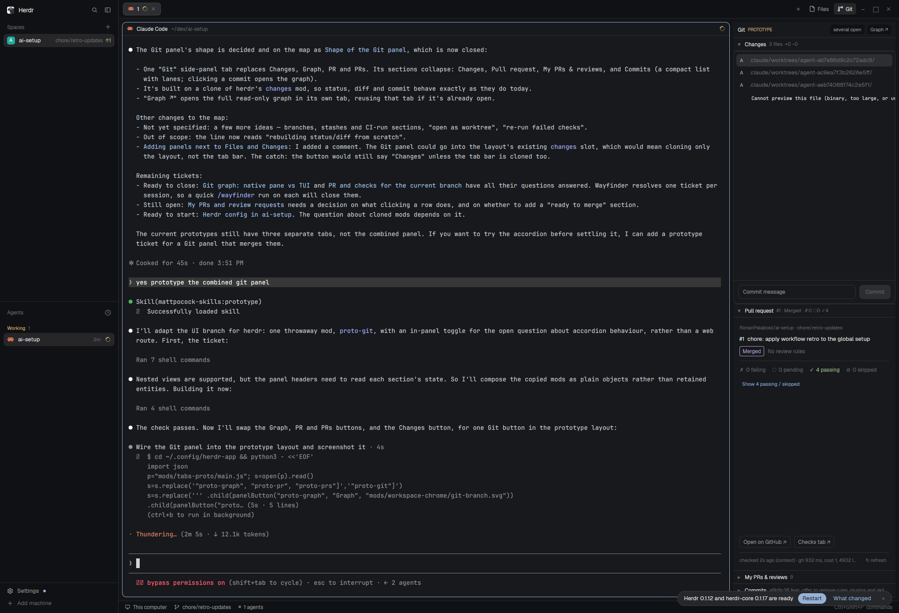

# Git panel prototype (throwaway)

Answers "Git panel prototype" on the map "Herdr git & GitHub integration". One **Git** side-panel tab with accordion sections, replacing the Changes button:

- **Changes**: a copy of herdr's shipped `changes` mod (`changes.js`), its own header hidden.
- **Pull request**: `proto-pr-pane` (PR + checks of the current branch).
- **My PRs & reviews**: `proto-prs-panel` (its demo button cycles real / fixture / a public user).
- **Commits**: `commits.js`, `git log --graph -n 40` of the current branch, read-only. Clicking a commit opens the graph tab (selecting that commit isn't supported yet: a toast says so).
- Header: **one open / several open** toggle (the open question), **Graph ↗** opens `proto-graph-community` in a tab named "Graph", reused if open.

Sections are plain objects composed in `main.js`, so the headers can read each section's state for their summaries.

## Install

Copy `mods/*` into `~/.config/herdr-app/mods/` and `layouts/main-proto.json` into `~/.config/herdr-app/layouts/`, then `herdr-app do layout.switch '{"name":"main-proto"}'`. Needs `proto-graph-community` (branch `prototype/git-graph`). `ctrl-shift-l` switches back to `main`.

`tabs-proto` and `main-proto` are clones of herdr's `tabs` mod and `main` layout: the Changes button is hidden, a Git button opens the `proto-git` slot.

